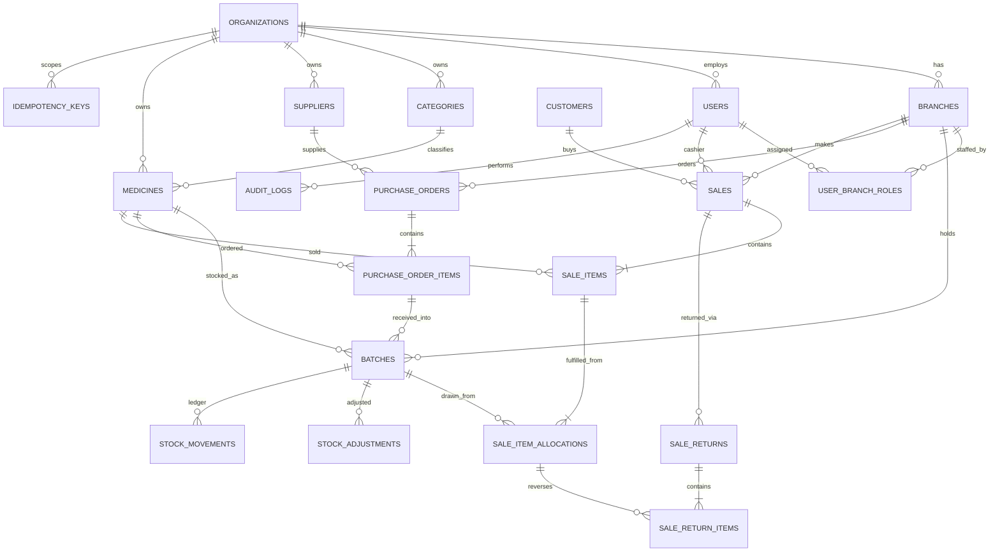

# Pharmacy Management System — Full Project Plan

> **Assignment:** ALGIONS AI LABS PRIVATE LIMITED — Full-Stack Web Development, *Pharmacy Management System*
> **Deadline:** 15 calendar days from the invitation date (exact date/timezone is in your individual invitation)
> **Document purpose:** a complete, explainable blueprint — what to build, with which tools, in which order, and what to watch out for.

---

## Table of Contents

1. [Decisions locked in](#1-decisions-locked-in)
2. [What the brief actually requires (and how this plan maps to it)](#2-what-the-brief-actually-requires)
3. [The "1 million users" question — scope and honesty](#3-the-1-million-users-question)
4. [Architecture overview](#4-architecture-overview)
5. [Tech stack (with the reason for each choice)](#5-tech-stack)
6. [Repository structure](#6-repository-structure)
7. [Multi-branch tenancy design](#7-multi-branch-tenancy-design)
8. [Database design](#8-database-design)
9. [Core business logic (the 30-mark part)](#9-core-business-logic)
10. [API design](#10-api-design)
11. [Authentication and RBAC](#11-authentication-and-rbac)
12. [Backend security hardening](#12-backend-security-hardening)
13. [Redis — what it is used for and what it must never be used for](#13-redis)
14. [Scalability plan (to ~1M users)](#14-scalability-plan)
15. [Load balancer and local infrastructure](#15-load-balancer-and-local-infrastructure)
16. [Reliability, observability and failure handling](#16-reliability-observability-and-failure-handling)
17. [Frontend plan (Next.js)](#17-frontend-plan)
18. [Testing strategy](#18-testing-strategy)
19. [15-day schedule](#19-15-day-schedule)
20. [Deployment on free tiers](#20-deployment-on-free-tiers)
21. [Submission package checklist](#21-submission-package-checklist)
22. [Things to keep in mind — pitfalls list](#22-pitfalls-and-things-to-keep-in-mind)
23. [Interview / live-debugging preparation](#23-interview-preparation)
24. [Defaults I chose that you can still change](#24-defaults-that-you-can-still-change)

---

## 1. Decisions locked in

These came from your answers. Everything below is built on them.

| Area | Decision |
|---|---|
| Frontend | **Next.js (App Router)** + React + TypeScript |
| Backend | **NestJS** (modular monolith) + TypeScript |
| ORM | **Prisma** (raw SQL where row locks / constraints are needed) |
| Database | **PostgreSQL** |
| Cache / in-memory | **Redis** |
| Tenancy | **Multi-branch / multi-tenant, shared schema** with `organization_id` + `branch_id` on every tenant-owned row |
| Scale target | ~1M users: **scalable design + local proof** (Docker Compose with Nginx load balancer, multiple API replicas, Redis, Postgres, load-test script) and a documented path to the full 1M |
| Delivery | **Docker Compose locally** + **free-tier demo** deployment, with a local-only fallback |
| Output of this task | One extensive Markdown plan (this file) |

---

## 2. What the brief actually requires

The brief is the grading contract. Your 100 marks are split like this, and the plan is organised around it:

| Rubric item | Marks | Where this plan covers it |
|---|---:|---|
| Core workflows and business-rule correctness | 30 | §9 |
| Architecture, data model and APIs | 20 | §4, §6, §8, §10 |
| Security, authorization and data integrity | 15 | §11, §12, §9.6 |
| UI/UX and responsive behaviour | 10 | §17 |
| Testing and reliability | 15 | §16, §18 |
| Documentation and demo | 10 | §21 |

**The five acceptance tests you must demonstrate** (build the whole project backwards from these):

1. A sale deducts quantity from the **correct batch** and records a **stock movement**.
2. An **expired batch cannot be sold**.
3. The system **warns about low stock and near-expiry** batches.
4. Returns/adjustments **require a reason** and are **auditable**.
5. The **stock report reconciles** with opening stock + purchases − sales ± adjustments.

**Mandatory technical items from the brief:**

- Separate UI / business logic / persistence (a modular monolith is explicitly enough — microservices are *not* required).
- Authentication + **server-side** RBAC (never only hiding buttons).
- Schema with relationships, validation, indexes, repeatable migrations + seed; ER diagram.
- Consistent APIs with server-side validation and predictable errors.
- Protection against stale availability, duplicate requests, invalid state transitions (transactions, constraints, idempotency).
- Search / filter / pagination; accessible forms; loading / empty / success / error states.
- Dashboard/report + audit trail.
- Unit + integration/API tests, including at least one negative/conflict case.
- Reproducible local setup; demo deployment if feasible; **no paid hosting**.
- Fictional products only; **no medical advice**.
- Deliverables: repo, README, ER diagram, OpenAPI docs, tests, demo URL/local steps, 3–5 min video, short technical report.

> **Strategy point:** the brief says *"Build a strong, correct MVP rather than many incomplete screens."* The 1M-user work is a **bonus layer on top of a correct core**. If you ever have to choose, correctness of batch inventory beats scale features.

---

## 3. The 1 million users question

### 3.1 What "1M users" should mean

"1M users" is ambiguous. Three different numbers matter and they differ by 100×:

| Number | Meaning | Typical ratio |
|---|---|---|
| Registered users | Rows in `users` | 1,000,000 |
| Daily active users (DAU) | Users who log in on a given day | 10–25% |
| Peak concurrent users / requests per second | What actually stresses servers | 1–5% of registered users, a few thousand RPS |

### 3.2 Planning estimate (assumptions — validate with your load test)

```
Registered users                 1,000,000
Daily active (20%)                 200,000
Requests per active user / day          60
Total requests / day            12,000,000
Average RPS over 24h                   ~140
Business hours only (10h window)       ~330 RPS
Peak (5× the busy-hours average)    ~1,500–2,000 RPS   ← design target (round to 3,000 RPS with headroom)
Read : write ratio (assumed)         85 : 15
Peak write RPS                        ~300–450 (sales, returns, receipts)
```

A single well-tuned PostgreSQL primary on modest cloud hardware handles a few hundred multi-statement transactions per second **if** transactions are short, indexes are right, and connections are pooled. The real risks are **not raw RPS** but: connection exhaustion, hot-row lock contention, unbounded tables (`stock_movements`, `audit_logs`), slow reports hitting the primary, and unpaginated queries.

### 3.3 Honest scope: what you *build* vs. what you *document*

You chose "scalable design + local proof". That means:

| Layer | Built and demonstrated locally | Documented as the path to 1M (not built) |
|---|---|---|
| App tier | Stateless NestJS API; **3 replicas behind Nginx** in Compose | Autoscaling group / Kubernetes HPA |
| Cache | Redis for rate limits, caching, idempotency fast-path, token denylist | Redis Cluster / managed Redis with replicas |
| DB | Indexed schema, keyset pagination, PgBouncer (optional), monthly partitioning on ledger tables (stretch) | Read replicas, Citus / sharding by `organization_id`, archival |
| Async | BullMQ jobs for nightly expiry scans and report generation | Dedicated worker fleet, dead-letter queues |
| Proof | **k6 load-test script + results table** in the README | Multi-region, CDN, WAF |

**Do not claim** "supports 1M users" in the README without evidence. Claim: *"designed to scale horizontally to ~1M registered users; load-tested to X RPS on a laptop with Y replicas; remaining path documented."* Reviewers reward honesty (the rubric explicitly lists "honest limitations").

---

## 4. Architecture overview

### 4.1 High-level diagram

```mermaid
flowchart LR
  U[Browser<br/>Next.js UI] -->|HTTPS| LB[Nginx<br/>reverse proxy + load balancer<br/>edge rate limit]
  LB -->|/| WEB[Next.js web<br/>container(s)]
  LB -->|/api| API1[NestJS API #1]
  LB -->|/api| API2[NestJS API #2]
  LB -->|/api| API3[NestJS API #3]
  API1 & API2 & API3 --> R[(Redis<br/>rate limit, cache,<br/>idempotency, denylist, queues)]
  API1 & API2 & API3 --> PGB[PgBouncer<br/>optional]
  PGB --> PG[(PostgreSQL primary)]
  PG -. streaming replication<br/>documented path .-> PGR[(Read replica<br/>reports)]
  W[Worker process<br/>BullMQ jobs] --> R
  W --> PG
```

### 4.2 Same-origin routing (important decision)

Put **Nginx in front of both** the Next.js app and the API so that the browser sees one origin:

- `https://pharmacy.local/` → Next.js
- `https://pharmacy.local/api/*` → NestJS

Why: auth cookies can be `HttpOnly; Secure; SameSite=Lax`, **no CORS** is needed, and CSRF exposure shrinks. In development use Next.js `rewrites` to proxy `/api` to the backend.

### 4.3 Where each concern lives (the "separation" the brief asks for)

| Layer | Responsibility | Never contains |
|---|---|---|
| **Next.js UI** | Screens, forms, client-side validation for UX, calling the API | Business rules, stock math, authorization decisions |
| **NestJS controllers** | HTTP concerns: routing, DTO validation, guards, response shaping | Business rules, SQL |
| **NestJS services (domain layer)** | Business rules: FEFO, state machines, tax calc, reconciliation | HTTP types |
| **Repository / Prisma layer** | Persistence, transactions, locks | Business decisions |
| **PostgreSQL** | Final guard: constraints, CHECKs, triggers, unique keys | — |

> **Next.js caution:** the brief wants UI and business logic separated. Do **not** put business logic in Next.js Server Actions or Route Handlers. Use Next.js purely as the UI; all rules live in NestJS. This is easy to explain in the interview and it keeps the API testable.

### 4.4 Modular monolith — NestJS modules

```
AuthModule            login, refresh, logout, password hashing
UsersModule           users, role assignment per branch
OrganizationsModule   organization, branches, settings (tax, near-expiry window)
CatalogModule         medicines, categories
SuppliersModule       suppliers
PurchasingModule      purchase orders, goods receipt (creates batches)
InventoryModule       batches, stock movements, adjustments, alerts   ← the core
SalesModule           sales, invoices, FEFO allocation
ReturnsModule         sale returns (and purchase returns, stretch)
ReportsModule         sales, valuation, expiry, reconciliation
AuditModule           append-only audit log
CommonModule          guards, interceptors, filters, idempotency, tenant context
JobsModule            BullMQ processors (expiry scan, alert snapshot)
HealthModule          /health, /ready
```

Rule: modules talk through **service interfaces**, not by importing each other's Prisma models. For example, `SalesService` calls `InventoryService.allocateFefo(...)`; it does not reach into the `batches` table directly. That gives you clean seams if you ever split out a service.

---

## 5. Tech stack

### 5.1 Core

| Concern | Choice | Why |
|---|---|---|
| Language | TypeScript everywhere | One language, shared types/schemas |
| Backend framework | **NestJS** | Built-in modules, DI, guards, interceptors, Swagger — maps onto "maintainable architecture" |
| ORM / migrations | **Prisma** + `prisma migrate` | Typed queries, repeatable migrations; use `$queryRaw` for `SELECT … FOR UPDATE`; hand-written SQL in migrations for CHECKs/triggers/partial indexes (Prisma schema can't express them) |
| Database | **PostgreSQL 16** | Row-level locking, CHECK constraints, partial/GIN indexes, partitioning, RLS, `NUMERIC` money |
| Cache / in-memory | **Redis 7** | Rate limiting, cache, idempotency, token denylist, BullMQ |
| Queue | **BullMQ** (on Redis) | Nightly expiry scan, report generation, alert snapshots |
| Validation | **Zod** (via `nestjs-zod`) shared with the frontend | One schema → API validation + form validation |
| Password hashing | **argon2id** (`argon2` package) | Current best-practice password hash |
| Auth tokens | JWT access (short) + rotating refresh token | See §11 |
| API docs | `@nestjs/swagger` → OpenAPI at `/api/docs` | Required deliverable |
| Logging | `nestjs-pino` (JSON, request-id) | Structured, fast |
| Frontend | **Next.js** App Router, React, Tailwind CSS, **shadcn/ui** (accessible Radix-based components), **TanStack Query**, **React Hook Form + Zod** | Accessible forms, cache/loading/error states out of the box |
| Tables | TanStack Table | Server-side pagination/sorting/filter |
| Charts | Recharts (dashboard) | Simple |

### 5.2 Testing and tooling

| Tool | Use |
|---|---|
| Jest | Unit tests (domain logic) |
| Supertest + Testcontainers (or a dedicated test Postgres in Compose) | Integration/API tests against real Postgres — **do not mock the database for stock tests** |
| Playwright | 1–3 end-to-end UI journeys (sale → invoice → report) |
| k6 | Load tests (scalability proof) |
| ESLint + Prettier + Husky + lint-staged | Code quality |
| `gitleaks` (pre-commit or CI) | Make sure no secret is committed (explicit brief requirement) |
| GitHub Actions (free) | CI: lint, test, build |
| Docker + Docker Compose | Reproducible environment |
| pnpm workspaces | Monorepo (api, web, shared) |

### 5.3 Infra (all free / local)

Nginx (LB + reverse proxy), PgBouncer (optional), Docker Compose. Free-tier demo hosting is covered in §20.

---

## 6. Repository structure

```
pharmacy-management-system/
├── apps/
│   ├── api/                      # NestJS
│   │   ├── prisma/
│   │   │   ├── schema.prisma
│   │   │   ├── migrations/       # includes hand-written SQL: CHECKs, triggers, RLS
│   │   │   └── seed.ts           # fictional data only
│   │   ├── src/
│   │   │   ├── main.ts
│   │   │   ├── common/           # guards, filters, interceptors, idempotency, tenant ctx
│   │   │   └── modules/
│   │   │       ├── auth/ users/ organizations/ catalog/ suppliers/
│   │   │       ├── purchasing/ inventory/ sales/ returns/ reports/
│   │   │       ├── audit/ jobs/ health/
│   │   └── test/                 # integration + e2e API tests
│   └── web/                      # Next.js
│       ├── app/ (routes) · components/ · lib/api-client.ts · hooks/
├── packages/
│   └── shared/                   # Zod schemas, enums, types shared by api + web
├── infra/
│   ├── nginx/nginx.conf
│   ├── docker-compose.yml        # nginx, web, api x3, postgres, redis, (pgbouncer)
│   └── k6/                       # load-test scripts
├── docs/
│   ├── architecture.md
│   ├── er-diagram.md (mermaid) + er-diagram.png
│   ├── technical-report.md
│   ├── test-evidence/            # screenshots / CI logs
│   └── load-test-results.md
├── .env.example                  # placeholders only
├── .gitignore                    # .env, node_modules, etc.
└── README.md
```

---

## 7. Multi-branch tenancy design

### 7.1 Model

```
Organization (a pharmacy chain / company)
 └── Branch (a physical store)  ← stock lives here
      └── Users assigned to one or more branches with a role
```

- **Catalogue data** (medicines, categories, suppliers) is **organization-level** (shared by all branches).
- **Stock data** (batches, movements, sales, returns, adjustments, POs) is **branch-level**.
- Every tenant-owned table carries `organization_id`; branch-owned tables also carry `branch_id`.

### 7.2 Enforcing isolation (defense in depth)

1. **Tenant context** — a Nest guard/interceptor resolves `organizationId` and the allowed `branchId`s from the **verified JWT**, never from request body/query. A user who sends `branch_id=<someone else's>` gets 403/404.
2. **Repository layer** — every query takes a `TenantContext` argument and adds `WHERE organization_id = ? [AND branch_id = ?]`. Make it hard to forget: wrap Prisma in a `TenantPrisma` helper (or a Prisma client extension) that injects the filter.
3. **Composite foreign keys** (cheap, powerful): e.g. `sale_items(sale_id, organization_id)` references `sales(id, organization_id)`, so a row can't point to another tenant's parent.
4. **PostgreSQL Row-Level Security (stretch / bonus)**: `SET LOCAL app.org_id = '…'` at the start of each transaction + `CREATE POLICY … USING (organization_id = current_setting('app.org_id')::uuid)`. This makes cross-tenant leaks impossible even when application code has a bug. With Prisma it works, but you must set the config inside the same transaction/connection as the queries (be careful with pooled connections). Do this only after the core is done.
5. **Tests** — an explicit integration test: user of Org A requests Org B's batch → 404.

### 7.3 Key tenancy pitfalls

- Never trust IDs alone: `GET /batches/:id` must check the batch belongs to the caller's branch scope.
- Cache keys **must include** `orgId` (and `branchId`): `org:{id}:branch:{id}:dashboard`. A missing tenant in a cache key is a data-leak bug.
- Unique constraints must be **per tenant**, e.g. `UNIQUE (organization_id, sku)`, `UNIQUE (branch_id, medicine_id, batch_number)`, not global.
- Invoice numbers are per branch.

---

## 8. Database design

### 8.1 ER diagram (Mermaid — paste into `docs/er-diagram.md`)



### 8.2 Tables and key columns

| Table | Important columns / constraints |
|---|---|
| `organizations` | `id uuid`, `name`, `settings jsonb` (tax config, near-expiry days, return window) |
| `branches` | `id`, `organization_id`, `name`, `code`, `timezone`; `UNIQUE(organization_id, code)` |
| `users` | `id`, `organization_id`, `email` (citext, unique per org), `password_hash`, `is_active`, `failed_login_count`, `locked_until` |
| `user_branch_roles` | `user_id`, `branch_id`, `role` (enum); `UNIQUE(user_id, branch_id, role)` |
| `categories` | `id`, `organization_id`, `name`; `UNIQUE(organization_id, name)` |
| `suppliers` | `id`, `organization_id`, `name`, `contact`, `is_active` |
| `medicines` | `id`, `organization_id`, `sku`, `name`, `generic_name`, `category_id`, `unit` (strip/bottle…), `tax_rate numeric(5,2)`, `requires_prescription bool`, `reorder_level int`, `is_active`; `UNIQUE(organization_id, sku)` |
| `batches` | `id`, `organization_id`, `branch_id`, `medicine_id`, `batch_number`, `expiry_date date`, `qty_on_hand int`, `purchase_price numeric(12,2)`, `sale_price numeric(12,2)`, `status` (ACTIVE/QUARANTINED/DEPLETED), `received_at`; **`CHECK (qty_on_hand >= 0)`**, `CHECK (sale_price >= 0)`, `UNIQUE(branch_id, medicine_id, batch_number)` |
| `purchase_orders` | `id`, `branch_id`, `supplier_id`, `status` (DRAFT→ORDERED→PARTIALLY_RECEIVED→RECEIVED / CANCELLED), `version int` (optimistic lock), totals |
| `purchase_order_items` | `po_id`, `medicine_id`, `qty_ordered`, `qty_received`, `unit_cost`; `CHECK (qty_received <= qty_ordered)` |
| `customers` | `id`, `organization_id`, `name`, `phone` (optional; **fictional data only**) |
| `sales` | `id`, `branch_id`, `invoice_number` (`UNIQUE(branch_id, invoice_number)`), `status` (COMPLETED/PARTIALLY_RETURNED/RETURNED/VOIDED), `cashier_id`, `subtotal`, `tax_total`, `grand_total`, `payment_method`, `idempotency_key`, `created_at` |
| `sale_items` | `sale_id`, `medicine_id`, `qty`, `unit_price`, `tax_rate` (**snapshot**), `tax_amount`, `line_total`; `CHECK (qty > 0)` |
| `sale_item_allocations` | `sale_item_id`, `batch_id`, `qty`, `unit_cost` (snapshot of purchase price for COGS/profit) — **one line can draw from several batches under FEFO** |
| `sale_returns` | `id`, `sale_id`, `branch_id`, `reason_code` (enum), `reason_note`, `created_by`; **reason NOT NULL** |
| `sale_return_items` | `return_id`, `allocation_id`, `qty`, `disposition` (RESTOCK / QUARANTINE / WRITE_OFF); `CHECK (qty > 0)` |
| `stock_adjustments` | `id`, `batch_id`, `qty_delta` (≠ 0), `reason_code` (DAMAGE, THEFT, COUNT_CORRECTION, EXPIRED_WRITE_OFF, OTHER), `reason_note` (NOT NULL), `created_by`, (`approved_by` stretch) |
| `stock_movements` | **append-only ledger** — `id bigint`, `organization_id`, `branch_id`, `batch_id`, `medicine_id`, `type` (OPENING, PURCHASE_RECEIPT, SALE, SALE_RETURN, ADJUSTMENT, EXPIRY_WRITE_OFF, TRANSFER_OUT/IN), `qty_delta int`, `balance_after int`, `ref_type`, `ref_id`, `created_by`, `created_at` |
| `audit_logs` | `id bigint`, `organization_id`, `actor_user_id`, `action`, `entity_type`, `entity_id`, `before jsonb`, `after jsonb`, `request_id`, `ip`, `created_at` — append-only |
| `idempotency_keys` | `organization_id`, `key`, `request_hash`, `status` (IN_PROGRESS/DONE), `response_code`, `response_body jsonb`, `created_at`; `PRIMARY KEY (organization_id, key)` |
| `refresh_tokens` | `id`, `user_id`, `family_id`, `token_hash`, `expires_at`, `revoked_at`, `replaced_by` |

### 8.3 Money and numbers

- Use `NUMERIC(12,2)` (Prisma `Decimal`) — **never floats** for money. Alternatively store integer minor units. Pick one and use it everywhere.
- Quantities are integers in the sellable unit. If you later allow loose tablets from strips, add a `units_per_pack` conversion rule instead of fractional quantities.
- Snapshot **price, tax rate and unit cost** into `sale_items` / allocations. Changing a medicine's price tomorrow must not alter yesterday's invoice or profit.
- Document the rounding rule (e.g. round tax per line to 2 dp, half-up) — invoices must be reproducible.

### 8.4 Constraints that enforce the business rules at the database level

Prisma's schema can't express everything; put these in a hand-written SQL migration:

```sql
-- Stock can never go negative, even if application code has a bug
ALTER TABLE batches ADD CONSTRAINT batches_qty_non_negative CHECK (qty_on_hand >= 0);

-- Reasons are mandatory
ALTER TABLE stock_adjustments
  ADD CONSTRAINT adj_reason_required CHECK (length(trim(reason_note)) >= 5),
  ADD CONSTRAINT adj_delta_nonzero  CHECK (qty_delta <> 0);

-- Append-only ledger and audit log: block UPDATE / DELETE
CREATE FUNCTION forbid_mutation() RETURNS trigger AS $$
BEGIN RAISE EXCEPTION '% is append-only', TG_TABLE_NAME; END; $$ LANGUAGE plpgsql;

CREATE TRIGGER stock_movements_immutable
  BEFORE UPDATE OR DELETE ON stock_movements
  FOR EACH ROW EXECUTE FUNCTION forbid_mutation();
CREATE TRIGGER audit_logs_immutable
  BEFORE UPDATE OR DELETE ON audit_logs
  FOR EACH ROW EXECUTE FUNCTION forbid_mutation();
```

(`TRUNCATE` is separate from row-level triggers; also revoke `UPDATE, DELETE, TRUNCATE` on these tables from the application DB role.)

### 8.5 Indexes (each one justified by a query)

| Index | Serves |
|---|---|
| `batches (branch_id, medicine_id, expiry_date, id) WHERE qty_on_hand > 0 AND status='ACTIVE'` (partial) | **FEFO allocation** — the hottest query in the app |
| `batches (branch_id, expiry_date) WHERE qty_on_hand > 0` | Near-expiry / expired report |
| `medicines (organization_id, sku)` unique; `GIN` trigram index on `name` (`pg_trgm`) | Search-as-you-type on the POS screen |
| `sales (branch_id, created_at DESC)` | Sales list / report, keyset pagination |
| `sales (branch_id, invoice_number)` unique | Invoice lookup |
| `stock_movements (batch_id, created_at)` and `(branch_id, created_at)` | Batch history, reconciliation report |
| `audit_logs (organization_id, created_at DESC)`, `(entity_type, entity_id)` | Audit viewer |
| `idempotency_keys` PK `(organization_id, key)` | Duplicate-request detection |
| `user_branch_roles (user_id)` | Login → permissions |

Verify with `EXPLAIN (ANALYZE, BUFFERS)` and keep a screenshot as evidence for the report. Low-stock queries compare the **sum** of on-hand quantity per medicine/branch to `reorder_level`; at larger scale maintain a `branch_stock_summary` table (updated in the same transaction as the ledger) or a materialized view instead of aggregating batches every time.

### 8.6 Migrations and seed ("repeatable")

- `prisma migrate dev` while developing; `prisma migrate deploy` in Docker/CI.
- `npm run db:reset` = drop → migrate → seed. A reviewer should reach a working app with: `cp .env.example .env && docker compose up --build`.
- Seed (**fictional only**): 1 org, 2–3 branches, 5 users (one per role), ~12 categories, ~80 fictional medicines (e.g. "Zentrol 500 mg"), ~10 suppliers, 200+ batches including **deliberately** an expired batch, near-expiry batches, a low-stock medicine, and opening stock movements. Seeds make acceptance demos instant.
- Make the seed **idempotent** (`upsert`) so running it twice doesn't duplicate data.

---

## 9. Core business logic

This is the heart of the project — 30 of 100 marks plus most of the "integrity" marks.

### 9.1 Stock model: batches + ledger

- `batches.qty_on_hand` is the **current balance** (fast to read).
- `stock_movements` is the **append-only history**. Every change to `qty_on_hand` writes exactly one movement row **in the same transaction**, with `qty_delta` and `balance_after`.
- **Invariant (what you test and show):** for every batch, `SUM(stock_movements.qty_delta) == batches.qty_on_hand`. A reconciliation job/report checks this.
- Never update `qty_on_hand` outside `InventoryService`. One writer = one place to get it right.

### 9.2 Sale creation algorithm (FEFO + concurrency-safe)

```
POST /api/v1/sales            Header: Idempotency-Key: <uuid>
Body: { branchId, customerId?, items: [{ medicineId, qty }], paymentMethod }
```

1. **Authorize**: guard checks role has `sales:create` for this branch.
2. **Validate** body (Zod): qty integer > 0, no duplicate medicine lines (merge them), max lines.
3. **Idempotency**: look up `(org, key)`. Same key + same request hash → return the stored response. Same key + different hash → `422 IDEMPOTENCY_KEY_REUSED`. In-progress → `409`.
4. **Begin transaction** (`READ COMMITTED` + explicit row locks is enough and fastest; see 9.3).
5. Sort items by `medicineId` (**consistent lock order → no deadlocks** between concurrent sales).
6. For each item, **lock candidate batches in FEFO order**:

   ```sql
   SELECT id, qty_on_hand, expiry_date, sale_price, purchase_price
   FROM batches
   WHERE branch_id = $1 AND medicine_id = $2
     AND status = 'ACTIVE'
     AND qty_on_hand > 0
     AND expiry_date >= (CURRENT_DATE_IN_BRANCH_TZ + $min_shelf_days)
   ORDER BY expiry_date ASC, id ASC
   FOR UPDATE;
   ```

7. Walk the locked rows, taking `min(remaining, qty_on_hand)` from each → one `sale_item_allocation` per batch used. If total available < requested → **abort the whole sale** with `409 INSUFFICIENT_STOCK` including which medicine and how many are available. (If the only stock is expired, return `409 BATCH_EXPIRED`/`NO_SELLABLE_STOCK` — acceptance test #2.)
8. For each allocation: `UPDATE batches SET qty_on_hand = qty_on_hand - $n WHERE id=$id` (the `CHECK` constraint is the last safety net), insert a `stock_movements` row (`type=SALE`, negative `qty_delta`, `balance_after`).
9. Get the invoice number: `UPDATE branch_invoice_counters SET last_no = last_no + 1 WHERE branch_id=$1 RETURNING last_no` (gapless per branch, serialised per branch only). Format e.g. `BR01-2026-000123`.
10. Insert `sales`, `sale_items` (snapshot price/tax), compute totals server-side (**never trust totals from the client**).
11. Insert `audit_logs` row (`SALE_CREATED`) and store the idempotency response.
12. **Commit.** Any error → the whole thing rolls back; no partial stock deductions.
13. After commit (not inside the tx): invalidate Redis caches for dashboard/alerts and enqueue low-stock check.

**Why `FOR UPDATE` and not just `UPDATE … WHERE qty_on_hand >= n`?** The conditional update is a good cheap guard for a single batch, but FEFO spans several batches and needs a consistent view to decide the allocation. Locking the candidate rows in a fixed order is simple, correct, and explainable. An alternative you can mention: `SERIALIZABLE` isolation with retry on `40001` — correct but needs retry logic and has more aborts under contention.

**Why not `SKIP LOCKED`?** It maximises concurrency for queue-like workloads, but here it would let a concurrent sale skip an older-expiry batch and break strict FEFO, or falsely report "insufficient stock". Choose plain `FOR UPDATE`; mention the trade-off in the report.

### 9.3 Preventing the three classic failures

| Failure | Mechanism |
|---|---|
| **Stale availability** (two cashiers sell the last strip) | `SELECT … FOR UPDATE` on batches inside the transaction + `CHECK (qty_on_hand >= 0)`; second sale gets `409 INSUFFICIENT_STOCK` |
| **Duplicate request** (double click, network retry) | `Idempotency-Key` + unique `(org, key)` row; the UI generates a UUID when the checkout form opens and disables the button while pending |
| **Invalid state transition** | Domain state machines (below) + conditional updates (`UPDATE … WHERE status = 'ORDERED'`, check affected rows = 1) + optimistic `version` on POs |

### 9.4 State machines

```
Purchase order:  DRAFT → ORDERED → PARTIALLY_RECEIVED → RECEIVED
                   │         └──────────────→ CANCELLED (only before any receipt)
Sale:            COMPLETED → PARTIALLY_RETURNED → RETURNED
                   └──→ VOIDED (same day, manager only, restores stock; or skip voids and use returns only)
Batch:           ACTIVE ⇄ QUARANTINED → DEPLETED
```

Implement as an explicit transition map in code (`canTransition(from, to)`) and unit-test every allowed *and* disallowed pair (e.g. cannot receive a CANCELLED PO, cannot return more than sold).

### 9.5 Goods receipt (purchases create batches)

- `POST /purchase-orders/:id/receive` with `[{ itemId, batchNumber, expiryDate, qty, purchasePrice, salePrice }]`.
- In one transaction: validate expiry date is in the future (reject receiving already-expired stock), create/increase the batch, write `PURCHASE_RECEIPT` movement, update `qty_received`, move PO status, audit log.
- Receiving the same batch number twice for the same medicine should **add to the existing batch** only if expiry and prices match; otherwise reject with a clear error.

### 9.6 Returns and adjustments

**Sale returns**

- Must reference the **original sale item allocation** so stock returns to the *same batch* it came from.
- Rules: `qty ≤ sold − already returned` (check inside the transaction with the allocation row locked), within the configured return window, **reason required** (enum + note).
- `disposition`: `RESTOCK` (re-add to batch; blocked if the batch is now expired — force `WRITE_OFF`), `QUARANTINE` or `WRITE_OFF` (no sellable stock added back but still logged).
- Writes a `SALE_RETURN` movement, updates sale status, audit log, refund amount computed server-side from the snapshot price/tax.

**Stock adjustments**

- `reason_code` + non-empty `reason_note` mandatory (also enforced by DB CHECK).
- Cannot make `qty_on_hand` negative (`409 WOULD_GO_NEGATIVE`).
- Stretch: adjustments above a threshold need a Branch Manager approval (`PENDING_APPROVAL → APPROVED`), which shows another state machine and audit story.

**Expiry write-off**: a manager action (or nightly job suggestion) that adjusts expired batches to zero with reason `EXPIRED_WRITE_OFF`, so valuation reports exclude them with a full trail.

### 9.7 Expiry and alerts

- **Expired** = `expiry_date < today` (in the **branch's timezone**, not the server's). Add an org setting `min_shelf_life_days` (default 0). Decide and document whether the expiry date itself is still sellable (recommended: sellable through the expiry date, blocked after — state it in the README).
- **Near-expiry window** is configurable (default 90 days).
- **Low stock**: total sellable quantity per medicine per branch `<= reorder_level`. Count only non-expired, ACTIVE batches.
- Surface alerts in: dashboard widgets, a dedicated Alerts page, and at POS (warning badge when a line draws from a near-expiry batch; hard block when expired).
- Nightly BullMQ job: mark batches that crossed expiry as unsellable (or just rely on the query filter — the query filter is the source of truth; the job only generates notifications/snapshots).

### 9.8 Invoice

- Printable invoice view (`/sales/:id/invoice`) with a print stylesheet (`@media print`) — itemised lines, batch + expiry per line, tax breakdown, totals, branch details, and a footer "Demo data — not a real pharmacy. No medical advice."
- Optional PDF endpoint later; browser print satisfies the brief ("printable invoice details").
- **Tax:** the brief says "configured tax fields". Keep tax rate on the medicine (and optionally an org-level default), snapshot into the line, compute `tax_amount` and `line_total` on the server, and show subtotal / tax / grand total.

### 9.9 The reconciliation report (acceptance test #5)

For a date range and branch, per medicine (and optionally per batch):

```
Opening stock   = SUM(qty_delta) of movements before period start
+ Purchases     = SUM where type = PURCHASE_RECEIPT in period
− Sales         = SUM where type = SALE in period            (negative)
+ Sale returns  = SUM where type = SALE_RETURN
± Adjustments   = SUM where type IN (ADJUSTMENT, EXPIRY_WRITE_OFF)
= Calculated closing
Actual closing  = SUM(batches.qty_on_hand)                    (or ledger balance at period end)
Difference      = Actual − Calculated   → must be 0
```

Display a green "Reconciled ✔" or a red variance row. Also include a test that deliberately corrupts a batch quantity in a scratch DB and proves the report flags it — it shows you understand *why* the report exists.

### 9.10 Audit trail

Write an `audit_logs` row **inside the same transaction** as the business change, so you can never have a change without a log (or vice-versa). Log: sale created, return created, adjustment, PO status changes, goods receipt, price changes, user/role changes, logins/failed logins, permission-denied events. Store actor, branch, entity, before/after (redact secrets), request-id, IP. Provide an audit viewer filtered by date / user / action / entity, available to Admin/Auditor roles.

---

## 10. API design

### 10.1 Conventions

- Base path `/api/v1`. JSON. Plural nouns. Versioned.
- **Validation**: Zod at the edge; reject unknown fields (`strict`).
- **Pagination**: keyset (cursor) for large, growing tables (`sales`, `stock_movements`, `audit_logs`): `?limit=25&cursor=<opaque>`. Offset pagination is fine for small tables (categories, suppliers). Always cap `limit` (max 100).
- **Search/filter**: `?q=para&categoryId=…&status=…&from=…&to=…`; sort allow-list (never interpolate a sort column from user input).
- **Idempotency**: required on `POST /sales`, `/returns`, `/adjustments`, `/purchase-orders/:id/receive`.
- **Time**: ISO-8601 UTC in the API; branch timezone applied for "today" logic and display.

### 10.2 Predictable error format (RFC 7807-style)

```json
{
  "type": "https://pharmacy.local/errors/insufficient-stock",
  "title": "Insufficient stock",
  "status": 409,
  "code": "INSUFFICIENT_STOCK",
  "detail": "Requested 20 of 'Zentrol 500 mg' but only 12 are sellable.",
  "errors": [{ "field": "items[0].qty", "message": "Only 12 available" }],
  "requestId": "01J…"
}
```

One global exception filter maps every error (validation, Prisma unique violation `P2002`, Prisma `P2025`, `40001`/`40P01` retries, domain errors) to this shape. **Never** leak stack traces or SQL in production. Define a fixed list of `code`s (`VALIDATION_FAILED`, `UNAUTHENTICATED`, `FORBIDDEN`, `NOT_FOUND`, `INSUFFICIENT_STOCK`, `BATCH_EXPIRED`, `INVALID_STATE_TRANSITION`, `DUPLICATE_REQUEST`, `IDEMPOTENCY_KEY_REUSED`, `RATE_LIMITED`, `WOULD_GO_NEGATIVE`).

Status codes: 400 malformed · 401 not logged in · 403 not allowed · 404 not found / not yours · 409 conflict (stock, state) · 422 semantic validation · 429 rate-limited (with `Retry-After`).

### 10.3 Endpoint inventory (MVP)

| Area | Endpoints |
|---|---|
| Auth | `POST /auth/login` · `POST /auth/refresh` · `POST /auth/logout` · `GET /auth/me` |
| Users (admin) | `GET/POST /users` · `PATCH /users/:id` · `PUT /users/:id/branch-roles` |
| Org/Branches | `GET/POST /branches` · `PATCH /branches/:id` · `GET/PATCH /org/settings` |
| Catalogue | `GET/POST /medicines` · `GET/PATCH /medicines/:id` · `GET/POST /categories` · `GET/POST /suppliers` · `PATCH /suppliers/:id` |
| Purchasing | `GET/POST /purchase-orders` · `GET /purchase-orders/:id` · `POST /purchase-orders/:id/order` · `POST …/receive` · `POST …/cancel` |
| Inventory | `GET /batches` (filters: medicine, expiring, expired, low) · `GET /batches/:id` · `GET /batches/:id/movements` · `GET /stock-movements` · `POST /stock-adjustments` · `GET /alerts` |
| Sales | `POST /sales` · `GET /sales` · `GET /sales/:id` · `GET /sales/:id/invoice` |
| Returns | `POST /sales/:id/returns` · `GET /returns` |
| Reports | `GET /reports/sales` · `/reports/stock-valuation` · `/reports/expiry` · `/reports/reconciliation` · `/reports/dashboard` (+ `?format=csv`) |
| Audit | `GET /audit-logs` |
| Ops | `GET /health` · `GET /ready` · `GET /docs` (Swagger) |

Keep the controllers thin and annotate with `@ApiTags`, `@ApiResponse`, and DTO schemas so Swagger documents every request/response including error cases. Export `openapi.json` into `docs/`.

---

## 11. Authentication and RBAC

### 11.1 Authentication flow

- Login: email + password → verify with **argon2id** → issue:
  - **Access token** (JWT, ~15 min) in an `HttpOnly; Secure; SameSite=Lax` cookie.
  - **Refresh token** (opaque random, ~7 days) in a separate `HttpOnly` cookie scoped to `/api/v1/auth`.
- **Refresh rotation with reuse detection**: store only a **hash** of the refresh token with a `family_id`. Each refresh issues a new token and marks the old one used. If an already-used token is presented again → revoke the whole family (token theft signal) and force re-login.
- **Logout**: revoke the refresh token; add the access token's `jti` to a Redis **denylist** with TTL = remaining lifetime.
- **Brute-force defense**: per-account + per-IP rate limit on login (Redis), exponential lockout after N failures (`locked_until`), generic error message (`Invalid credentials` — don't reveal whether the email exists), constant-time compare, and an audit entry for failures.
- Password policy: min length 12, no composition rules theatre; check against a small common-password list; **never log passwords**.
- Optional stretch: TOTP 2FA for Admin.

> Using cookies means state-changing requests need CSRF protection. With same-origin routing (§4.2), `SameSite=Lax` plus requiring a custom header (e.g. `X-Requested-With`) or a double-submit CSRF token on non-GET requests is sufficient. Mention this in the report.

### 11.2 Roles and permissions

Authorization is **server-side**: a global `AuthGuard` (authentication) + `RolesGuard`/`PermissionsGuard` (authorization) + tenant/branch check. The UI hides buttons only for usability.

| Role | Scope |
|---|---|
| `ORG_ADMIN` | Everything in the organisation: branches, users, settings, all reports, audit |
| `BRANCH_MANAGER` | Everything within assigned branches: approve adjustments, write-offs, void/return, reports |
| `PHARMACIST` | Sell, handle returns, view stock/alerts, catalogue read; (prescription-flag items) |
| `CASHIER` | Create sales, print invoices, view own sales; no stock edits |
| `INVENTORY_CLERK` | Purchase orders, goods receipt, adjustments (with reason), batches |
| `AUDITOR` | Read-only reports + audit log |

Define permissions as constants (`sales:create`, `inventory:adjust`, `reports:read`, `audit:read`, `users:manage` …) and map roles → permissions in one file. Controllers use `@Permissions('sales:create')`. Add an **integration test per sensitive endpoint** that a lower role receives 403 — a negative case the brief explicitly wants.

---

## 12. Backend security hardening

Checklist you can tick in the README and explain in the interview.

### 12.1 Rate limiting (layered)

| Layer | Tool | Policy (example values; tune with load test) |
|---|---|---|
| **Edge** | Nginx `limit_req_zone` / `limit_conn` | e.g. 20 req/s per IP burst 40 globally; connection cap per IP; stricter on `/api/v1/auth/*` |
| **App – global** | `@nestjs/throttler` with a **Redis storage adapter** (e.g. `@nest-lab/throttler-storage-redis`) | 100 req/min per authenticated user, 60/min per IP for anonymous |
| **App – sensitive** | Same module, named throttlers | Login: 5 attempts / 15 min per (IP + email); `POST /sales`: e.g. 30/min per user; reports (expensive): 10/min per user |
| **Per-tenant fairness** (stretch) | Redis token bucket keyed by `org_id` | Prevents one organisation from starving others (noisy neighbour) |

Details that matter:

- **Redis-backed** counters are essential: with 3 API replicas, in-memory counters would let a client send 3× the limit (each replica counts separately). This is a great point to make in the interview.
- Return `429` with `Retry-After` and the standard error body; log + audit repeated violations.
- Set `app.set('trust proxy', ...)` correctly so `req.ip` is the real client IP from `X-Forwarded-For` set by Nginx. If you forget this, **every request appears to come from the load balancer's IP** and the limiter throttles everyone together.
- Decide Redis-down behaviour deliberately: **fail-open** for general limits (log loudly; fall back to a small in-memory limiter) but **fail-closed** for login throttling. Document it.

### 12.2 Transport and headers

- HTTPS everywhere (TLS terminated at Nginx; for local use a self-signed cert or mkcert; free hosting gives TLS for free). HSTS in production.
- `helmet` on the API; a strict **CSP** and security headers on Next.js (`next.config` headers): `X-Content-Type-Options`, `Referrer-Policy`, `frame-ancestors 'none'`.
- Same-origin → no wildcard CORS. If you ever need CORS, allow-list exact origins; never `*` with credentials.
- `Cookie` flags: `HttpOnly`, `Secure`, `SameSite=Lax`, minimal `Path`.
- Request **body size limits** (e.g. 100 KB for JSON) and request **timeouts**.

### 12.3 Input and injection

- Validate **everything** server-side with Zod; strip/deny unknown properties; whitelist sort/filter fields.
- Use Prisma's parameterised queries. In `$queryRaw`, use the **tagged template** form (`` prisma.$queryRaw`SELECT … ${id}` ``), never `$queryRawUnsafe` with string concatenation.
- Output encoding: React escapes by default; never use `dangerouslySetInnerHTML` with user data (supplier names, notes).
- UUID primary keys (non-enumerable) to reduce IDOR guessing — but still check ownership on every access (IDOR/BOLA is the #1 API risk).
- Mass-assignment protection: DTOs expose only allowed fields; never spread `req.body` into Prisma.

### 12.4 Secrets and data

- `.env` in `.gitignore`; commit only `.env.example` with placeholders; run `gitleaks` on the repo (and git history) before submission.
- Dummy demo credentials only, printed in README (e.g. `admin@demo.test / <demo password>`), flagged as demo-only. Rotate nothing real because nothing real exists.
- No real personal data. Customers are fictional; if you store phone numbers, mask them in logs and UI.
- Least privilege DB roles: migration role (DDL) vs app role (DML only; no `DROP`, no `UPDATE/DELETE` on `audit_logs`/`stock_movements`).
- Redact `password`, `token`, `authorization` from logs (pino `redact`).
- `npm audit` / Dependabot, lockfile committed, pin Docker image versions, run containers as non-root.

### 12.5 Application-level protections

- Generic error messages to clients; details only in server logs with a `requestId`.
- Graceful handling of Postgres errors: unique violation → 409; serialization failure/deadlock (`40001`, `40P01`) → retry up to N times with jitter, then `503/409`.
- Account lockout, session revocation on password change / deactivation, `is_active` checked on every request (or short token lifetime).
- Authorization events (403s) are audit-logged.

### 12.6 OWASP API Top 10 mapping (put this table in your report)

| Risk | Your mitigation |
|---|---|
| Broken object-level authorization | Tenant + branch checks in repositories, composite FKs, optional RLS, IDOR tests |
| Broken authentication | argon2id, short JWT, rotating refresh, lockout, rate limits |
| Broken object property-level authz | DTO allow-lists, no mass-assignment |
| Unrestricted resource consumption | Rate limits, pagination caps, body limits, timeouts, expensive-report throttling |
| Broken function-level authz | Permission guards on every route + per-endpoint 403 tests |
| Unrestricted access to sensitive business flows | Idempotency, per-user caps on sales/returns, return-window rule |
| Security misconfiguration | Helmet, CSP, no stack traces, locked-down CORS, non-root containers |
| Improper inventory management | OpenAPI as the single route inventory; no hidden debug routes in production |
| Unsafe consumption of APIs | No third-party calls in the MVP |

---

## 13. Redis

### 13.1 What Redis is used for

| Use | How | Source of truth |
|---|---|---|
| **Rate limiting** | Throttler storage (sliding window / token bucket) | Redis (ephemeral by nature) |
| **Response caching** | Cache-aside for read-heavy, tolerant-of-staleness data: medicine search results/catalogue (TTL 60–300 s), dashboard aggregates (30–60 s), alert counts (60 s) | **Postgres** |
| **Idempotency fast path** | Optional `SET idem:{org}:{key} NX EX 86400` to reject in-flight duplicates cheaply before touching Postgres | **Postgres** `idempotency_keys` |
| **Token denylist / session revocation** | `jti` → TTL | Redis + DB `refresh_tokens` |
| **Login lockout counters** | `INCR` with expiry | Redis (+ `locked_until` in DB) |
| **Job queue** | BullMQ (nightly expiry scan, report generation, alert snapshots) | Redis (jobs), Postgres (results) |
| **Distributed lock for cron** | `SET lock NX PX` so only one replica schedules jobs | Redis |

### 13.2 What Redis must NOT be used for (important to say out loud)

- **Never use a cached stock quantity to decide whether a sale is allowed.** Availability decisions happen inside the DB transaction against locked rows. Redis can *display* "approx. stock" in a search dropdown, but the sale path ignores it. Stale cache + stock = overselling.
- Redis is **not the system of record** for anything business-critical (sales, stock, audit). If Redis is wiped, the system must still be *correct* (just slower, and with limits reset).

### 13.3 Cache design rules

- Key format includes tenant: `v1:org:{orgId}:branch:{branchId}:dash:today`.
- **Invalidate on write** (delete keys after the transaction commits) *and* keep short TTLs as a backstop. Use a per-tenant "version counter" key (`INCR org:{id}:catalogue:ver`) embedded in cache keys so you can invalidate a whole family with one write.
- **Cache stampede protection**: when a hot key expires, use a short per-key lock (`SET NX`) or serve stale-while-revalidate so 1,000 requests don't all hit Postgres.
- Cache only GETs of non-personalised or per-tenant data; set `maxmemory` + `maxmemory-policy allkeys-lru` (or `volatile-lru`) for the cache instance. Don't mix queue data and cache data on the same eviction policy in production — use **separate Redis instances/DBs** (cache can evict; BullMQ must use `noeviction`).
- Local dev: `redis:7-alpine`; free demo: Upstash free tier (check its current command/size limits before relying on it).

---

## 14. Scalability plan

### 14.1 Principles

1. **Stateless API** — no in-process sessions/caches that matter; JWT + Redis make replicas interchangeable; scale by adding replicas.
2. **The database is the bottleneck** — keep transactions short, indexes tight, connections pooled, reads cached or offloaded.
3. **Measure, don't guess** — every claim backed by a k6 run or `EXPLAIN` output.

### 14.2 Scaling the database to ~1M users

| Technique | What / why | Build now? |
|---|---|---|
| **Right indexes** + partial indexes | See §8.5 | ✅ |
| **Keyset pagination** | `OFFSET 1,000,000` scans a million rows; keyset (`WHERE (created_at,id) < (?,?) ORDER BY … LIMIT 25`) is O(log n) | ✅ |
| **Connection pooling** | Each API replica has a Prisma pool (e.g. 10); with 3 replicas = 30 connections. At 50 replicas that would exceed Postgres `max_connections` → put **PgBouncer** (transaction mode) between them (Prisma needs `?pgbouncer=true`; avoid session-level features like advisory locks across statements). | ✅ optional in Compose |
| **Short transactions** | No network calls/Redis calls/emails inside a transaction; lock rows late, release early (sale tx should be ~10–30 ms) | ✅ |
| **Summary tables / materialized views** | `branch_stock_summary` (updated in the sale tx) or nightly materialised views for dashboards and low-stock instead of aggregating 100M ledger rows | ✅ summary; MV optional |
| **Partitioning** | Partition `stock_movements`, `audit_logs`, (and `sales`) by month (`PARTITION BY RANGE (created_at)`); drop/archive old partitions cheaply; keeps indexes small | Stretch, document |
| **Read replicas** | Route heavy report queries (read-only) to a replica; accept replication lag for reports, *never* for sales | Document |
| **Vertical first, then horizontal** | A larger primary goes very far; beyond it shard by `organization_id` (Citus or app-level) — the shared-schema + `organization_id` design already makes that possible | Document |
| **Archival** | Move sales/movements older than N years to cold storage; reports over archived data use aggregates | Document |
| **Autovacuum tuning** | High-churn `batches` rows → lower `autovacuum_vacuum_scale_factor` for that table; keep `fillfactor` ~90 to enable HOT updates | Document/do |
| **Hot-row contention** | A popular batch row or the invoice counter row serialises concurrent sales *within one branch*. Acceptable (a single branch has limited tills). Across branches there's no contention. Mention alternatives: per-till counters, batching. | Explain |

### 14.3 Scaling the application tier

- Replicas behind Nginx (`least_conn`), health checks, graceful shutdown so rolling deploys don't drop requests.
- Move CPU-heavy/slow work out of the request path to BullMQ workers (report generation, CSV export, alert recomputation). Run **workers as a separate process/container** from the API.
- Compression (gzip/brotli at Nginx), HTTP keep-alive to upstreams, ETag/`Cache-Control` for static Next.js assets (served via CDN in production).
- Pagination caps and payload size caps everywhere (a single "list everything" endpoint can take the system down).

### 14.4 Capacity sanity check (put your measured numbers here)

| Item | Estimate | How to validate |
|---|---|---|
| Sale transaction | ~8–12 SQL statements, 10–30 ms | k6 on `POST /sales` |
| One Postgres primary | hundreds of such tx/s | k6 + `pg_stat_statements` |
| 3 API replicas | thousands of cached reads/s | k6 on search/dashboard |
| Ledger growth | e.g. 10,000 branches × 300 sales/day × ~3 lines ≈ 9M ledger rows/day ⇒ **partitioning is mandatory at real 1M-user scale** | Compute from your own assumptions and show your arithmetic |

### 14.5 Load-test plan (the "local proof")

k6 scenarios (store scripts in `infra/k6/`, results in `docs/load-test-results.md`):

1. **Read-heavy mix**: login once → hit medicine search, batches list, dashboard (80% of traffic).
2. **Write mix**: `POST /sales` with unique idempotency keys.
3. **Contention test**: 200 virtual users all buying the **same medicine's last 50 units** → exactly 50 succeed, rest get 409, final quantity is 0 and never negative, ledger sums to balance. *This single test is the most convincing evidence in the whole project.*
4. **Idempotency test**: send the same request 50× in parallel → exactly 1 sale created.
5. **Rate-limit test**: confirm 429s appear at the expected threshold across all 3 replicas.
6. **Soak**: 10–15 minutes at moderate load; watch memory, connections, p95/p99 latency.

Report: RPS, p50/p95/p99, error rate, CPU/DB connections, and **what the bottleneck was** and what you'd do next. Targets to aim for (adjust to your machine): p95 < 300 ms reads, p95 < 800 ms sales, error rate < 1% excluding intentional 409/429.

---

## 15. Load balancer and local infrastructure

### 15.1 `docker-compose.yml` (shape)

```yaml
services:
  nginx:
    image: nginx:1.27-alpine
    ports: ["80:80"]
    volumes: ["./infra/nginx/nginx.conf:/etc/nginx/nginx.conf:ro"]
    depends_on: [web, api]

  web:                      # Next.js
    build: ./apps/web
    environment: [ "NEXT_PUBLIC_API_BASE=/api/v1" ]

  api:                      # scaled: docker compose up --scale api=3
    build: ./apps/api
    env_file: .env
    depends_on:
      postgres: { condition: service_healthy }
      redis:    { condition: service_healthy }
    deploy: { replicas: 3 }
    healthcheck: { test: ["CMD","wget","-qO-","http://localhost:3000/health"], interval: 10s }

  worker:                   # BullMQ processors (same image, different command)
    build: ./apps/api
    command: node dist/worker.js
    env_file: .env

  pgbouncer:                # optional
    image: edoburu/pgbouncer
    environment: { DB_HOST: postgres, POOL_MODE: transaction, MAX_CLIENT_CONN: 1000, DEFAULT_POOL_SIZE: 25 }

  postgres:
    image: postgres:16-alpine
    volumes: ["pgdata:/var/lib/postgresql/data"]
    healthcheck: { test: ["CMD-SHELL","pg_isready -U $$POSTGRES_USER"], interval: 5s }

  redis:
    image: redis:7-alpine
    command: ["redis-server","--maxmemory","256mb","--maxmemory-policy","allkeys-lru"]
    healthcheck: { test: ["CMD","redis-cli","ping"], interval: 5s }

volumes: { pgdata: {} }
```

(Use the compose "scale" mechanism that your Docker version supports — `deploy.replicas` or `--scale api=3`. When scaling, don't publish a fixed host port on `api`; only Nginx is exposed. For queues vs cache, add a second Redis with `noeviction`.)

### 15.2 `nginx.conf` essentials

```nginx
worker_processes auto;
events { worker_connections 4096; }

http {
  limit_req_zone $binary_remote_addr zone=api_zone:10m  rate=20r/s;
  limit_req_zone $binary_remote_addr zone=auth_zone:10m rate=5r/s;
  limit_conn_zone $binary_remote_addr zone=conn_zone:10m;

  upstream api_upstream {
    least_conn;
    server api:3000 max_fails=3 fail_timeout=10s;   # Docker DNS resolves to all replicas
    keepalive 64;
  }
  upstream web_upstream { server web:3000; keepalive 16; }

  server {
    listen 80;
    client_max_body_size 200k;
    gzip on;

    location /api/v1/auth/ {
      limit_req zone=auth_zone burst=10 nodelay;
      proxy_pass http://api_upstream;
      include proxy_headers.conf;
    }
    location /api/ {
      limit_req zone=api_zone burst=40 nodelay;
      limit_conn conn_zone 30;
      proxy_pass http://api_upstream;
      proxy_http_version 1.1;
      proxy_set_header Connection "";
      proxy_set_header X-Real-IP $remote_addr;
      proxy_set_header X-Forwarded-For $proxy_add_x_forwarded_for;
      proxy_set_header X-Forwarded-Proto $scheme;
      proxy_set_header X-Request-Id $request_id;
      proxy_connect_timeout 3s; proxy_read_timeout 30s;
      proxy_next_upstream error timeout http_502 http_503;   # only safe for idempotent requests!
    }
    location / { proxy_pass http://web_upstream; }
  }
}
```

Things to understand and be able to explain:

- **Round-robin vs `least_conn`**: `least_conn` is better when request durations vary (reports vs searches).
- Docker's DNS returns every replica's IP for `api`, but Nginx resolves upstream names **once at startup**; if replicas change you need a `resolver` + variable-based `proxy_pass`, or list replica names explicitly. Know this limitation.
- Open-source Nginx only has **passive** health checks (`max_fails`); active checks require Nginx Plus or an alternative like HAProxy/Traefik. State this honestly.
- **Retry danger:** `proxy_next_upstream` can replay a `POST` to another replica after a timeout, creating duplicate sales — **this is exactly why idempotency keys exist**. Prefer `proxy_next_upstream_tries 2` and don't retry non-idempotent requests unless they carry an idempotency key.
- Sticky sessions are **not needed** because the API is stateless.
- TLS termination at the LB, `X-Forwarded-*` headers, and `trust proxy` in Nest (see §12.1).

---

## 16. Reliability, observability and failure handling

- **Health endpoints**: `/health` (process alive) vs `/ready` (can reach Postgres + Redis). The LB and Docker use them; readiness gates traffic during startup.
- **Graceful shutdown**: on `SIGTERM`, stop accepting new requests, finish in-flight ones, close Prisma/Redis (`app.enableShutdownHooks()`).
- **Timeouts everywhere**: DB statement timeout (`statement_timeout`, e.g. 5 s for API role), `lock_timeout` (e.g. 2–3 s so a stuck lock returns `409/503` instead of hanging), Redis command timeout, HTTP timeouts.
- **Retries**: only for safe operations or idempotent ones; exponential backoff with jitter for `40001`/`40P01`.
- **Redis degradation**: the app keeps working (limits/cache degrade, see §12.1/§13.2).
- **Structured logs** (pino): `requestId`, `userId`, `orgId`, `branchId`, route, status, latency. Propagate `X-Request-Id` from Nginx through logs and error responses so a failed request can be traced end-to-end.
- **Metrics** (stretch): `prom-client` `/metrics` (request rate, latency histogram, DB pool use, queue depth, 409/429 counts).
- **Backups/restore** (document): `pg_dump` script in README; test restoring once.
- **Data integrity job**: nightly "ledger vs balance" verification that raises an alert if any batch's `SUM(movements) != qty_on_hand`.

---

## 17. Frontend plan

### 17.1 Principles with Next.js

- Use the **App Router** for layout/routing, but fetch data with **TanStack Query** from client components through a typed `api-client` that attaches the CSRF header and handles `401 → refresh → retry` once.
- Route protection in `middleware.ts` is a **UX redirect only**. The real enforcement is the API's guards.
- Role-aware navigation (hide what the role can't use) — but remember the API still returns 403 if someone calls it directly.
- Shared Zod schemas from `packages/shared` drive form validation and TypeScript types, so UI and API can't drift.

### 17.2 Screens (MVP priority order)

| # | Screen | Key features |
|---|---|---|
| 1 | Login | Error states, lockout message, loading |
| 2 | **POS / New Sale** | Medicine search-as-you-type (debounced), cart, qty validation, live FEFO preview ("will draw from batch B123 exp 2027-03"), near-expiry badge, expired block, totals, payment method, Idempotency-Key generated per checkout, disabled submit while pending, success → invoice |
| 3 | Invoice (printable) | Print stylesheet, batch/expiry per line, tax breakdown |
| 4 | Dashboard | Today's sales, low-stock count, near-expiry count, top sellers, recent activity |
| 5 | Medicines + categories | Table with server-side search/filter/sort/pagination; create/edit forms |
| 6 | Suppliers | CRUD |
| 7 | Purchase orders + goods receipt | Status chips, receive form capturing batch number/expiry/prices |
| 8 | Inventory / batches | Filter: all / low / near-expiry / expired; batch movement history drawer |
| 9 | Adjustments | Reason dropdown + mandatory note |
| 10 | Sales list + returns | Return dialog tied to original sale lines, reason required |
| 11 | Reports | Sales, valuation, expiry, **reconciliation**; date/branch filters; CSV export |
| 12 | Audit log | Filters by user/action/date/entity; expandable before/after |
| 13 | Admin | Users, roles, branches, settings (tax, near-expiry window) |
| 14 | Branch switcher | Global control in the header (scopes all data) |

### 17.3 UX/accessibility requirements (10 marks, and they are easy marks)

- Every list has **loading (skeleton), empty ("No batches near expiry 🎉"), error (with retry), and success (toast)** states — build one reusable `<DataState>` wrapper and use it everywhere.
- Accessible forms: `<label>` for each input, `aria-invalid`/`aria-describedby` for errors, focus moves to the first error, keyboard operable, visible focus ring, sufficient contrast, don't use colour alone (icon + text on expired/near-expiry badges).
- Responsive: mobile-first Tailwind; tables become cards on small screens; POS is usable on a tablet.
- Disable double-submit; confirm destructive actions; preserve form input on server error.
- Show server error `code`/`detail` in friendly language; map `409 INSUFFICIENT_STOCK` to an inline message on the offending cart line.
- Footer/banner: "Demo data only. This system provides no medical advice."
- Run Lighthouse accessibility and keep the score in the report.

---

## 18. Testing strategy

### 18.1 Test pyramid

| Level | Tooling | What to cover |
|---|---|---|
| **Unit** (fast, no DB) | Jest | FEFO allocation function (pure logic), tax/rounding, state-machine transitions, expiry/min-shelf logic with timezone edge cases, idempotency hash, permission matrix |
| **Integration / API** (real Postgres + Redis via Testcontainers or Compose) | Jest + Supertest | Full request → DB assertions for every acceptance test |
| **Concurrency** | Jest with `Promise.all`, plus k6 | Parallel sales on the same batch |
| **E2E UI** | Playwright | Login → search → sell → invoice → see it in report; 2 negative flows |
| **Load** | k6 | §14.5 |

### 18.2 Must-have test cases (map directly onto the brief)

**Acceptance tests**

1. Sale of 5 units drawn from FEFO batch → that batch's `qty_on_hand` decreases by 5, **one `SALE` movement** exists with `balance_after` correct, a later-expiry batch is untouched.
2. Sale spanning two batches (needs 15; batch A has 10, batch B has 20) → A→0, B→15, two allocations, two movements.
3. Medicine with only an expired batch → `409` and **no stock change, no movement, no sale row**.
4. Mixed stock (expired + valid) → expired is skipped, valid one is used.
5. Low-stock and near-expiry alerts appear at the thresholds (boundary values: exactly at threshold, one above, one below; exactly N days to expiry).
6. Return without reason → `422`; with reason → stock restored to original batch, movement + audit entry exist; return of expired batch can't be restocked.
7. Adjustment without reason → `422`/DB CHECK violation; negative result → `409`.
8. Reconciliation: after a scripted series of purchase/sale/return/adjustment, report shows Opening + … = Closing with **zero variance**; a corrupted batch produces a flagged variance.

**Negative / conflict / security**

- 200 concurrent buyers for 50 units → exactly 50 succeed; none negative.
- Same `Idempotency-Key` ×N → one sale; same key with different body → `422`.
- Cashier calling `POST /stock-adjustments` or `GET /audit-logs` → `403`.
- Org A user fetching Org B batch/sale → `404`.
- Branch X user selling in Branch Y → `403`.
- Return more than sold; return twice; return on a voided sale → rejected.
- Invalid state transition (receive a CANCELLED PO) → `409 INVALID_STATE_TRANSITION`.
- Rate limit → `429` after threshold; login lockout.
- Refresh token reuse → family revoked.
- Attempt `UPDATE`/`DELETE` on `stock_movements` or `audit_logs` → DB error.
- Mass-assignment: sending `grandTotal` or `unitPrice` in the sale body is ignored/rejected (server computes).

### 18.3 Evidence for the submission

- CI badge/logs (GitHub Actions) and a screenshot of the passing run; coverage report (aim for meaningful coverage on `inventory`, `sales`, `returns`, `reports` > 80%, don't chase vanity numbers).
- Commands in README: `pnpm test`, `pnpm test:integration`, `pnpm test:e2e`, `pnpm k6:contention`.
- Tests must be **reproducible**: fresh DB per run, fixed seed/clock (inject a `Clock` service so tests control "today" — otherwise expiry tests rot over time).

---

## 19. 15-day schedule

Aligned with the brief's suggested milestones, with concrete outputs per day.

| Day | Goal | Concrete outputs |
|---|---|---|
| **1** | Read brief, confirm acceptance criteria, repo setup | Repo + pnpm monorepo, README skeleton, `.gitignore`, `.env.example`, Docker Compose with Postgres+Redis, CI skeleton, gitleaks hook, user-journey list |
| **2** | Data model | Prisma schema, SQL migration for CHECKs/triggers/indexes, ER diagram v1 |
| **3** | API contracts + scaffold | NestJS modules, global filter (error format), Zod/validation pipe, Swagger setup, pino logging, health endpoints; Next.js scaffold with layout, API client |
| **4** | Auth + tenancy | Login/refresh/logout, argon2, JWT cookies, tenant context, `PermissionsGuard`, seed users per role, first auth/RBAC tests |
| **5** | Catalogue | Medicines, categories, suppliers APIs + screens (search/filter/pagination) |
| **6** | Purchasing + batches | PO state machine, goods receipt creating batches + movements, UI |
| **7** | **Sales engine** | FEFO allocation, transaction, locks, idempotency, invoice numbering, audit — unit + integration tests first |
| **8** | POS + invoice UI | POS screen, invoice print view, error/loading states |
| **9** | Returns + adjustments | Rules, disposition, reasons, UI, tests |
| **10** | Alerts + dashboard + reports | Low-stock/near-expiry, dashboard, sales/valuation/expiry/reconciliation reports + CSV |
| **11** | Security hardening + Redis | Redis rate limiting (Nginx + Nest), lockout, caching with invalidation, token denylist, Helmet/CSP, audit viewer |
| **12** | Scale proof | Compose with Nginx + 3 API replicas (+ PgBouncer), k6 scripts, contention/idempotency tests, `EXPLAIN` evidence, tune |
| **13** | Test + polish | Negative cases, Playwright flows, accessibility + responsive pass, fix defects, integrity-check job |
| **14** | Documentation + media | Final README, technical report (PDF/MD), ER + architecture diagrams, OpenAPI export, test evidence, 3–5 min video recorded, free-tier deploy |
| **15** | Freeze + submit | Regression run from a **clean clone**, verify every link works in a private window (repo access, video, report), final commit ID noted, **submit form before the deadline** |

Buffer rule: if you are behind at end of Day 8 — drop the PgBouncer, RLS, 2FA, partitioning, approval workflow, transfers and PDF export. Do **not** drop tests, audit, reconciliation, or the concurrency/idempotency work.

**Suggested stretch list (only after the MVP is green):** Row-Level Security, partitioned ledger tables, inter-branch stock transfers, adjustment approval workflow, TOTP 2FA, Prometheus metrics, PDF invoices, prescription capture for flagged medicines, barcode scanning (keyboard-wedge input).

---

## 20. Deployment on free tiers

The brief: "Do not pay for hosting or external services." Free tiers change often — **verify current limits and sleep/cold-start behaviour when you deploy**.

| Component | Candidate free options | Notes |
|---|---|---|
| Next.js web | Vercel hobby, Netlify, Cloudflare Pages | Easiest; set `NEXT_PUBLIC_API_BASE` |
| NestJS API | Render, Fly.io, Koyeb, Railway-style trials | Free instances may sleep → first request is slow; mention in README |
| PostgreSQL | Neon, Supabase, Aiven free | Pooled connection strings; run `prisma migrate deploy` + seed once |
| Redis | Upstash free tier | Check command/size caps; BullMQ needs a persistent connection — verify it works on the free plan or run workers locally/skip queues in the demo |
| Load balancer | **Local Compose only** | Free hosts already load-balance internally; the multi-replica LB is demonstrated locally in the video |

Cross-origin warning: if web and API are on different domains in the free demo, cookie auth needs `SameSite=None; Secure` + CORS allow-list + CSRF handling, which is more fragile than same-origin. Easiest fix: deploy through one origin (rewrites on Vercel `/api/*` → API URL) or serve both from one host. Decide on Day 14 at the latest; keep the **local-only declaration** ready as the fallback the brief allows.

Demo hygiene: seed with fictional data, show demo credentials in README and on the login page ("Demo accounts"), make sure the free DB never contains real data, and don't paste any production-style secrets anywhere.

---

## 21. Submission package checklist

**Repository**
- [ ] `apps/web`, `apps/api`, `packages/shared`, `infra`, `docs`
- [ ] Migrations + seed (repeatable), `.env.example` only (no `.env`, tokens, keys — run gitleaks on history)
- [ ] Clean clone → `cp .env.example .env && docker compose up --build` works
- [ ] Reviewer access if private (or make it public)

**README sections** (the brief lists these exactly)
- [ ] Overview + screenshots
- [ ] Architecture + diagram
- [ ] Tech stack
- [ ] Setup: Docker path **and** manual path
- [ ] Environment variables table
- [ ] Demo credentials (dummy) per role
- [ ] Database setup, migrate, seed, reset
- [ ] Test commands + how to run load test
- [ ] Business rules (FEFO, expiry rule, rounding, return window)
- [ ] **Known limitations** (honest: e.g. no RLS, no real payment, free tier sleeps, no partitioning if you skip it)
- [ ] AI-tool usage and library attribution (the form asks — be truthful and specific)

**Docs**
- [ ] ER diagram (image + mermaid source)
- [ ] OpenAPI (`/api/docs` live link + `openapi.json` committed)
- [ ] Technical report (≤ ~4–6 pages): architecture, why modular monolith, data model, FEFO/locking rationale, idempotency, security model, Redis usage, scalability analysis + load-test results, trade-offs, limitations
- [ ] Test evidence (CI run, coverage, concurrency test output)

**Video (3–5 minutes) — script**
1. (0:00) 20 s: what/stack/architecture picture.
2. (0:20) Login as Cashier → search → sell an item → invoice → show the batch quantity dropped + movement row.
3. (1:15) Try to sell the expired batch → blocked message.
4. (1:35) Dashboard: low-stock and near-expiry alerts.
5. (2:00) Return with reason; adjustment requiring reason; open Audit log.
6. (2:40) Reconciliation report = zero variance.
7. (3:10) RBAC: Cashier gets 403 on admin API (show in Swagger/devtools).
8. (3:30) Terminal: 3 API replicas + Nginx; k6 contention test result; rate-limit 429.
9. (4:20) Closing: limitations + what's next. **Keep it under 5 minutes.**

**Submission form fields:** name/reg no./university email, role + exact project title, repo URL + branch + **final commit ID**, video + demo URLs (or local-only declaration), README/report/diagram links, stack + limitations, AI/attribution, declarations. Check every link while logged out.

---

## 22. Pitfalls and things to keep in mind

**Correctness**
1. Treating stock as one number per medicine — the brief **explicitly penalises** this. Always batch-level.
2. Doing the availability check in application code then updating later → race condition. Check **and** update under the same row lock.
3. Float arithmetic for money. Use `Decimal`/`NUMERIC`.
4. Trusting client-sent price/tax/totals. Server recomputes.
5. Using server time for expiry. Use branch timezone; inject a `Clock` for tests.
6. Forgetting a sale line may span multiple batches (needs the allocations table) — and that returns must go back to the *originating* batch.
7. Changing a medicine's price rewriting old invoices — snapshot instead.
8. Ledger and balance drifting — only `InventoryService` mutates stock; add the integrity job.
9. Soft-delete vs hard-delete: never hard-delete medicines/batches/suppliers referenced by history; use `is_active`/status.
10. Audit log written outside the transaction (can disagree with reality).

**Scale/perf**
11. In-memory rate limiting with multiple replicas (per-replica counters). Use Redis.
12. Missing `trust proxy` → everyone behind Nginx looks like one IP.
13. `OFFSET` pagination on million-row tables; unbounded list endpoints.
14. N+1 queries from Prisma `include` in loops; check generated SQL; select only needed columns.
15. Prisma connection pool × replicas > Postgres `max_connections`.
16. Caching stock for sale decisions (never).
17. Slow reports running on the primary during peak (use replica/summary tables/job + cache).
18. Retrying a `POST` at the load balancer without idempotency.
19. Redis eviction wiping BullMQ jobs (use separate instance with `noeviction`).

**Security**
20. Only hiding buttons in UI; missing guards on an endpoint — test every route for 401/403.
21. IDOR across tenants/branches; cache keys without tenant.
22. Secrets in git history (even once committed, they live in history) → gitleaks.
23. Verbose errors leaking SQL/stack traces; logging passwords/tokens.
24. Cookie auth without CSRF thinking.
25. Real-looking personal data in seeds; real medicines/dosage advice in UI — use fictional names and the disclaimer.

**Process / evaluation**
26. Scope creep: you must be able to **explain and modify your own code live** in a 10-minute task (§23). Don't ship what you can't explain.
27. A large AI-generated codebase "without understanding" is explicitly penalised. Disclose AI use honestly; write the core inventory/sales logic and tests yourself or understand it line by line.
28. Many half-finished screens lose to few finished flows. Fewer screens, correct rules.
29. Broken/permission-blocked links count as **missing evidence**. Re-verify on Day 15 in a private window.
30. Don't pay for anything; keep everything reproducible from a clean clone.

---

## 23. Interview preparation

You will have a 15-minute walkthrough and a 10-minute live change/debugging task. Be able to answer, at the whiteboard:

- Walk through `POST /sales` end to end: where's the lock, where's the idempotency check, what rolls back on error?
- Why FEFO ordering `ORDER BY expiry_date, id` and why lock order matters (deadlock avoidance).
- What happens if two cashiers sell the last unit simultaneously? What if the same request is sent twice?
- Why `SELECT … FOR UPDATE` over `SERIALIZABLE` or `SKIP LOCKED`? Trade-offs.
- How does the reconciliation report prove integrity? What if it shows a variance?
- Why a modular monolith, and how would you split it later?
- How is multi-tenancy enforced? What would RLS add?
- How would the system handle 10× the load? Where does it break first? (DB connections / hot rows / ledger growth.)
- Why Redis-backed rate limits? What happens when Redis goes down?
- What did you *not* finish, and what would you do next?

Likely live changes to rehearse (practise doing each in <10 min): add a new adjustment reason code; add a configurable "minimum shelf-life days" check; change the near-expiry window; add a new filter to the batches list; add a field to the invoice; fix a seeded bug (e.g. off-by-one on expiry date, wrong rounding); add a new permission to a role.

---

## 24. Defaults that you can still change

You asked me not to assume things. These are the places where I still had to pick a default to make the plan concrete. **Please confirm or correct each one** and I will update the plan (and later, the code):

| # | Default I used | Alternative |
|---|---|---|
| 1 | Customers are **records** attached to sales (no customer login/portal), because you chose "multi-branch" rather than "customer portal" | Add a customer portal with its own login |
| 2 | Validation with **Zod** (shared with frontend) | `class-validator` (the NestJS default) |
| 3 | **shadcn/ui + Tailwind** for UI; **TanStack Query** for data fetching | MUI / Chakra; SWR |
| 4 | **pnpm workspaces** monorepo | Two separate repos |
| 5 | Tax is a **per-medicine percentage** with server-side rounding per line | Fixed org-level tax, or multiple tax components (e.g. CGST/SGST style) — tell me the tax scheme you want |
| 6 | Payments are only a **payment-method label** (cash/card/UPI-style) — no real payment gateway (brief forbids live payment credentials) | Simulated payment status |
| 7 | **Expiry date inclusive** (sellable on the expiry date, blocked the next day), plus configurable minimum remaining shelf-life | Block from the 1st of the expiry month, etc. |
| 8 | Inter-branch **stock transfers**, Row-Level Security, partitioning, 2FA, approval workflows = **stretch goals** | Make some of them mandatory |
| 9 | PgBouncer and read replica = optional/documented, not mandatory | Build both locally |
| 10 | Return window default **30 days**, configurable | Other policy |
| 11 | Free-tier demo target: Vercel (web) + Render/Fly (API) + Neon (Postgres) + Upstash (Redis) — **verify current free limits** | Local-only declaration (allowed by the brief) |

---

*End of plan. Next step once you confirm §24: I can scaffold the monorepo (Compose, Prisma schema + migrations, seed, NestJS modules, Next.js shell) and build in the order of the 15-day schedule — starting with the sales engine and its tests, since that is where most of the marks are.*
